# Referências de skins do Starve.io

Consulta: 4 de novembro de 2026. Escopo: imagens de skins de corpo para referência de modelagem no Blender.

## Resultado verificado

- 281 IDs com imagens públicas acessíveis, totalizando 562 arquivos PNG: dia e noite para cada ID.
- Foram consultados os IDs 0 a 300 nos caminhos `https://starve.io/img/day-skin<ID>.png` e `https://starve.io/img/night-skin<ID>.png`.
- Existem imagens para 0–129 e 131–281. O ID 130 e os IDs 282–300 retornaram HTTP 404 nas duas variantes.
- Todos os downloads foram validados pela assinatura PNG; dimensões, tamanho e SHA-256 constam no catálogo.
- Isso confirma cobertura dos arquivos nesse intervalo, não um inventário completo da loja. Skins especiais com outros caminhos, IDs fora do intervalo e imagens compostas por outras peças não foram descartadas.
- Os rótulos encontrados no changelog foram preservados para 82 IDs. Alguns são genéricos: não devem ser tratados como nomes oficiais verificados. Raridade e disponibilidade na loja ainda não foram conferidas.
- As duas variantes não contam como duas skins diferentes. IDs diferentes também podem ser variações do mesmo desenho.

## Dia e noite

No Starve.io a noite é desenhada na própria arte: a imagem de noite é quase sempre a mesma skin repintada em tons de azul/roxo. No Roblox quem escurece é a iluminação, então **a referência é só a imagem de dia**. Exceções conferidas por comparação: algumas skins mantêm partes acesas à noite (ex.: 233, chifres amarelos), que no Roblox viram material Neon; e algumas trocam de desenho (ex.: 109 é céu estrelado de dia e sol de noite), que só precisam de variante se quisermos esse efeito.

## Pranchas visuais (dia)

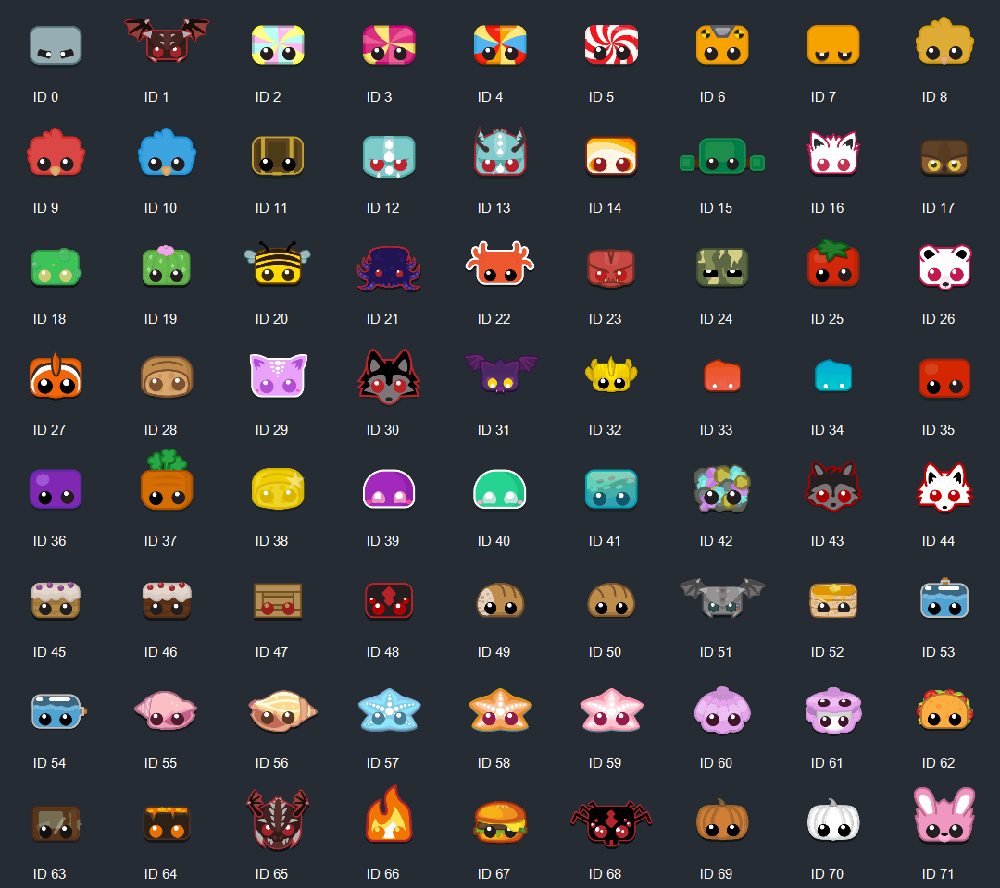

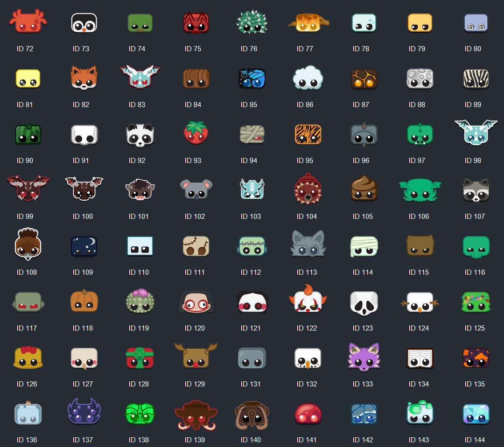

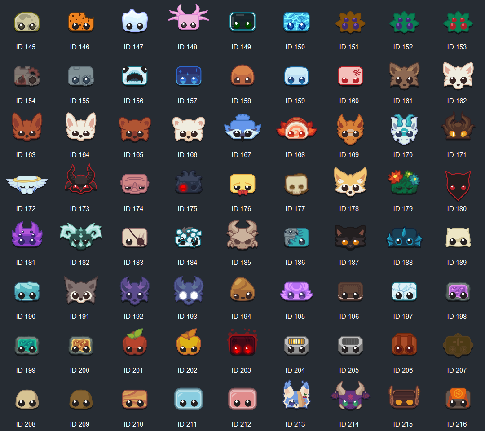

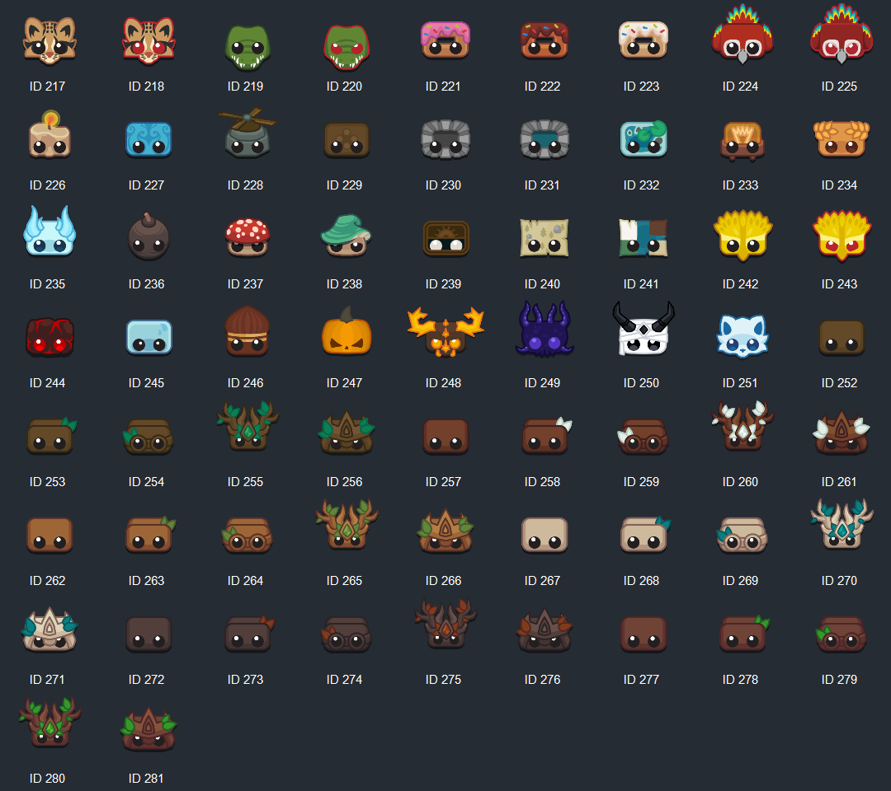

## Arquivos

- `catalog.json`: inventário com URLs, metadados, rótulos disponíveis e respostas dos arquivos ausentes.
- `catalog.csv`: índice simples para consulta.
- `images/`: PNGs de dia e noite, identificados pelo número original.
- `changelog.html`: cópia da fonte pública usada para associar rótulos.
- `../../../scripts/catalog-skin-references.mjs`: script de coleta e validação; executar a partir da raiz do projeto. As pranchas foram montadas separadamente.

Fontes: [jogo oficial](https://starve.io/) e [changelog oficial](https://starve.io/changelog.html). A tentativa de leitura direta da [wiki de skins](https://starveiopro.fandom.com/wiki/Skins) retornou HTTP 403.

## Outros cosméticos: acessórios, mochilas, livros e caixas

Consulta: 4 de novembro de 2026, IDs 0 a 250 em `https://starve.io/img/<day|night>-<categoria><ID>.png`. Cada categoria tem pasta própria com `images/`, `catalog.json`, `catalog.csv` e pranchas de dia.

| Pasta | Categoria no site | IDs com imagem | PNGs | Observações |
|---|---|---|---|---|
| `acessorios/` | `accessory` | 106 (0, 4, 9–112) | 210 | IDs 1–3 e 5–8 retornaram 404. O ID 0 é um PNG vazio de 99 bytes (“sem acessório”). Os IDs 0 e 17 só têm a versão de dia. |
| `mochilas/` | `bag` | 81 (0–80) | 162 | Sem lacunas. |
| `livros/` | `book` | 57 (0–56) | 114 | Sem lacunas. O ID 0 é o livro padrão. |
| `caixas/` | `crate` | 115 (0–114) | 230 | Sem lacunas. São as caixas de morte/saque; no nosso jogo, a categoria “Caixa” é uma só. |

Os rótulos do changelog foram preservados quando existem (36, 17, 14 e 29, respectivamente), com as mesmas ressalvas das skins: não são nomes oficiais verificados. Raridade e disponibilidade na loja não foram conferidas. Os acessórios são desenhados para ficar por cima da skin de corpo, então a posição de cada um na imagem já indica onde ele fica no rosto ou no corpo.

### Acessórios

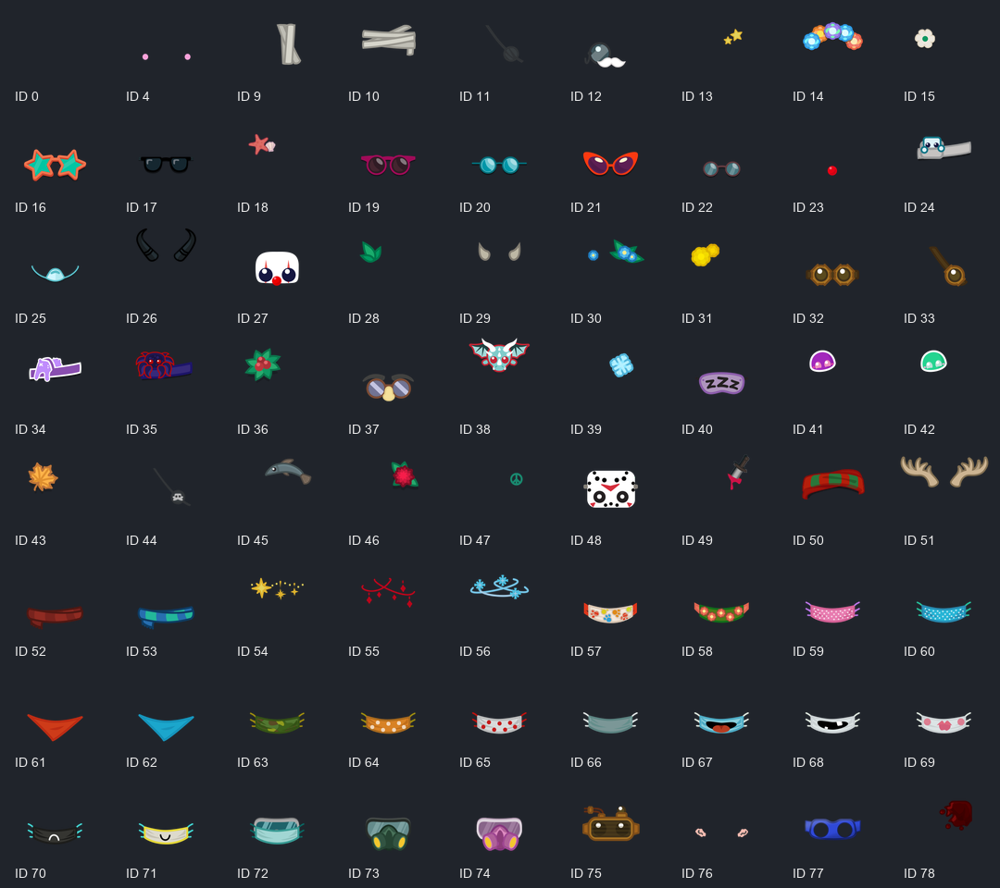

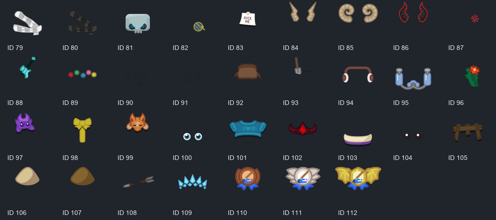

### Mochilas

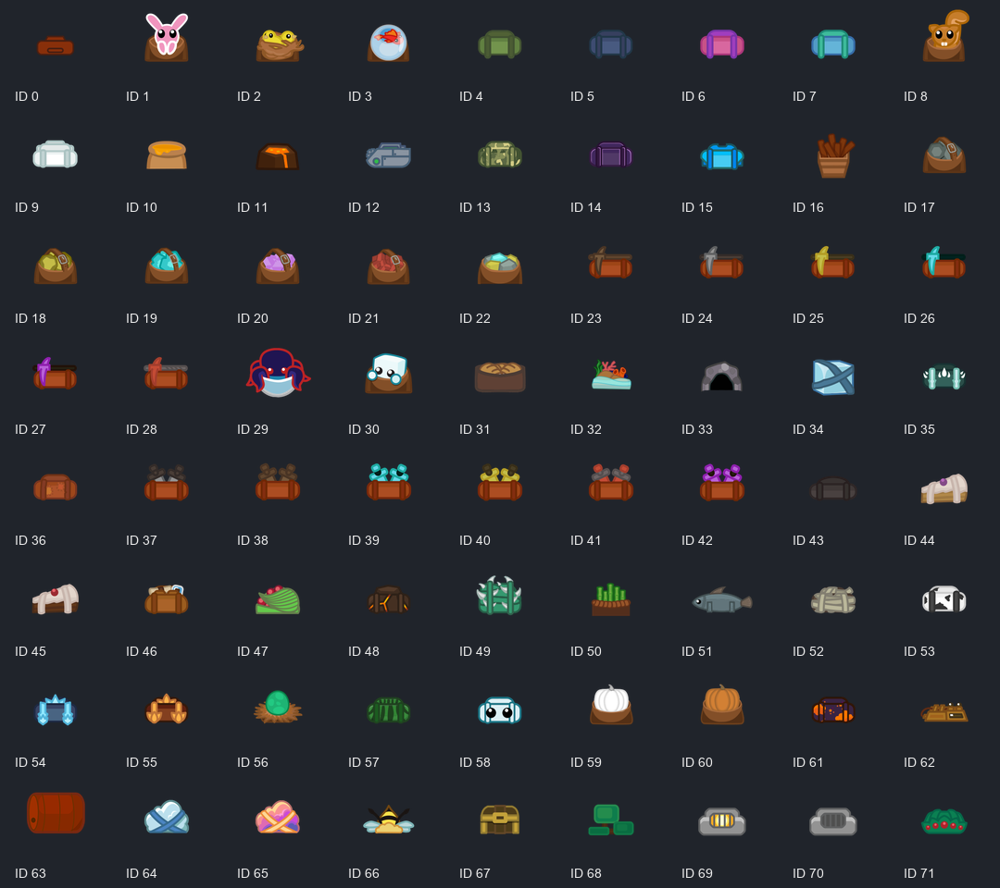

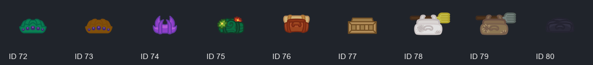

### Livros

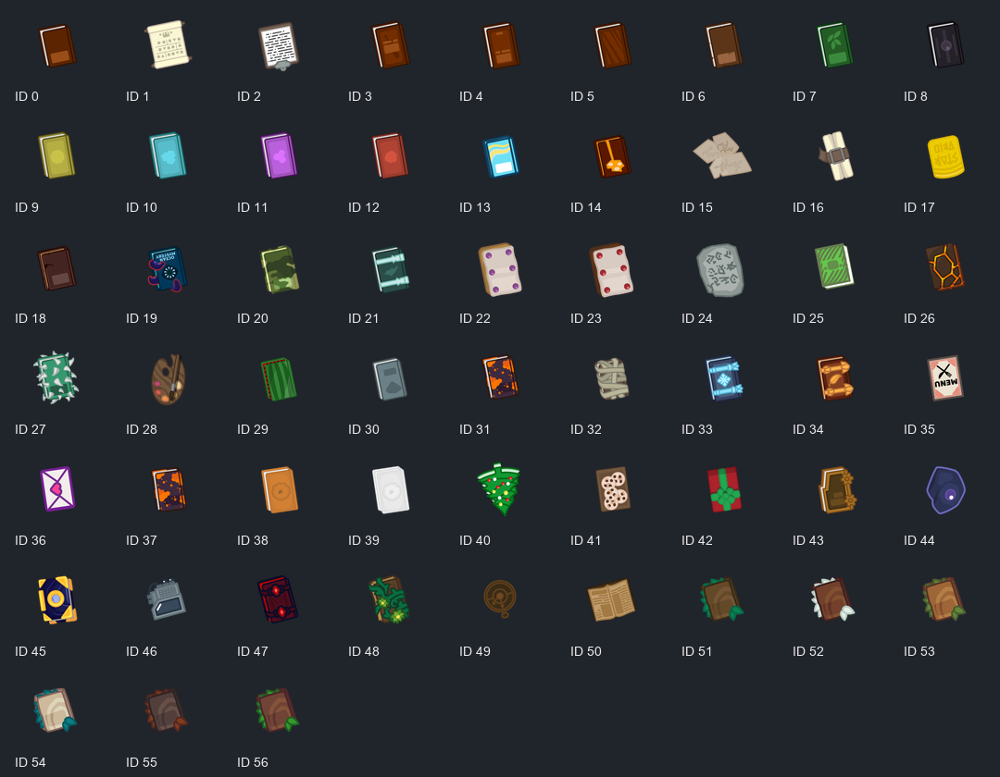

### Caixas

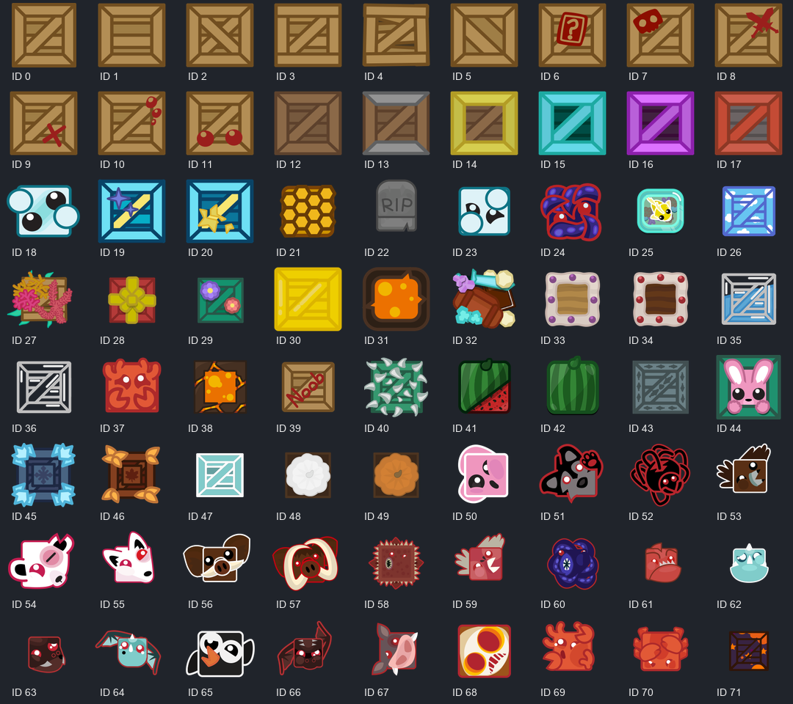

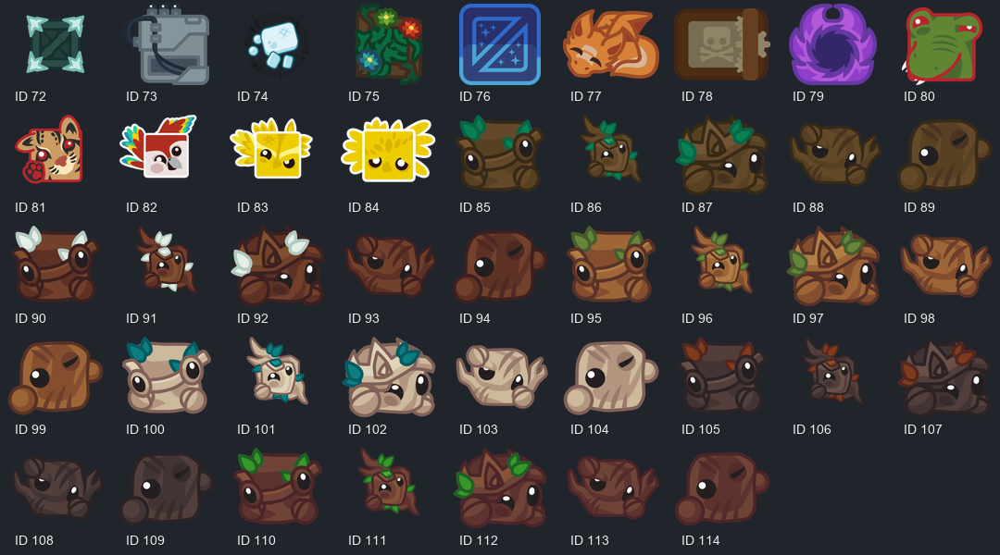

## Mãos das skins

Cada skin de corpo tem uma mão própria em `https://starve.io/img/<day|night>-hand-skin<ID>.png`, com o **mesmo ID da skin**. Foram consultados os IDs 0 a 300 e as imagens ficam em `maos/`.

- **274 IDs com mão**, 548 PNGs (dia e noite em todos), mas só **250 desenhos diferentes**: algumas variações de skin usam exatamente a mesma mão (SHA-256 igual): 124 e 130; 151 e 152; 162, 164 e 166; 163 e 165; 198 e 199; 204 e 205; 253–256; 258–261; 263–266; 268–270; 273–276; 278–281.
- **8 skins sem arquivo de mão:** 7, 44, 50, 54, 60, 121, 123 e 132. Nenhum outro nome de arquivo foi encontrado para elas. A maioria é variação de uma skin vizinha (7↔6, 50↔49, 54↔53), então provavelmente usam a mão dessa outra skin, mas isso **não foi confirmado**: o código do jogo é ofuscado e não mostra o mapeamento.
- O ID 130 tem mão (igual à da 124), mas não tem skin de corpo.
- A maioria das mãos é uma bolinha redonda com a cor/textura da skin. As temáticas têm formato próprio, por exemplo: 15 e 110 (quadradas), 21 e 106 (gota/tentáculo), 22, 65 e 72 (garra), 42 e 76 (cristal/espinhos), 64 (pedra), 66 (chama), 85 (gota), 93 (morango), 105 (cocô). Os tamanhos dos PNGs variam (de 43×43 a 86×90), então a escala da mão em relação ao corpo muda de skin para skin.

As pranchas mostram a skin (esquerda) e a mão (direita) lado a lado; “—” indica que não há arquivo:

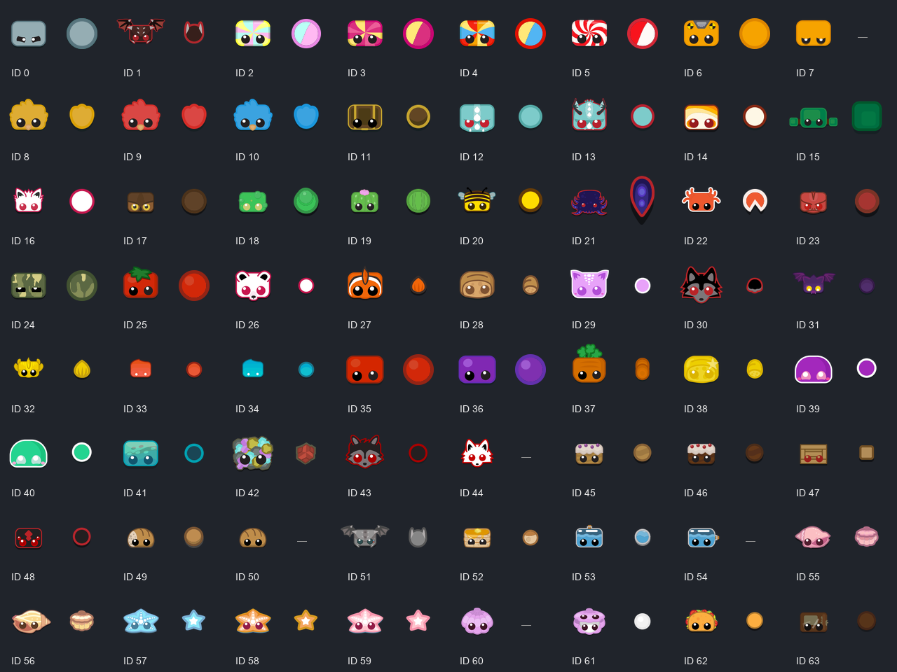

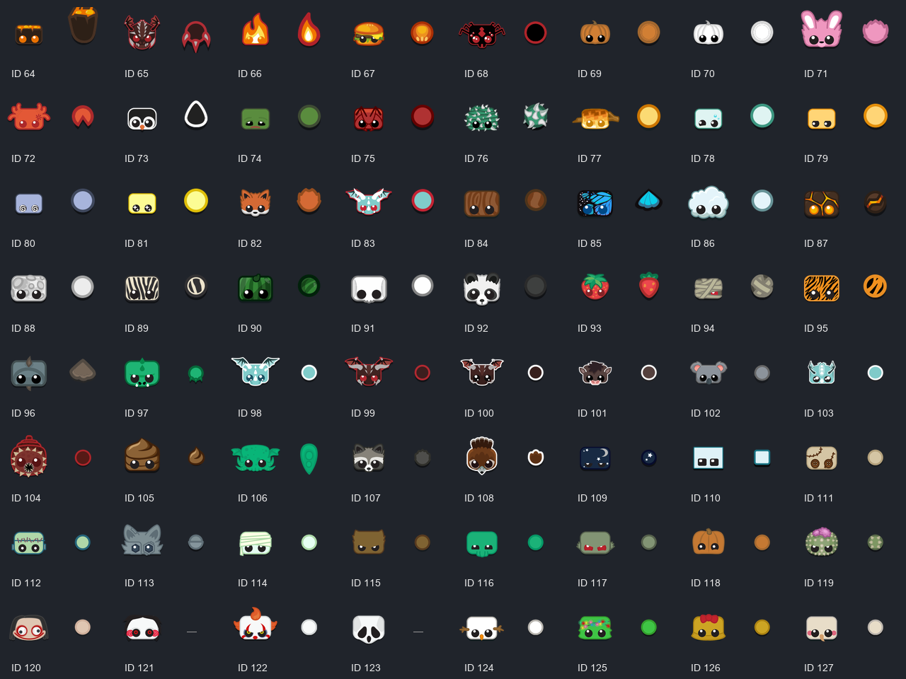

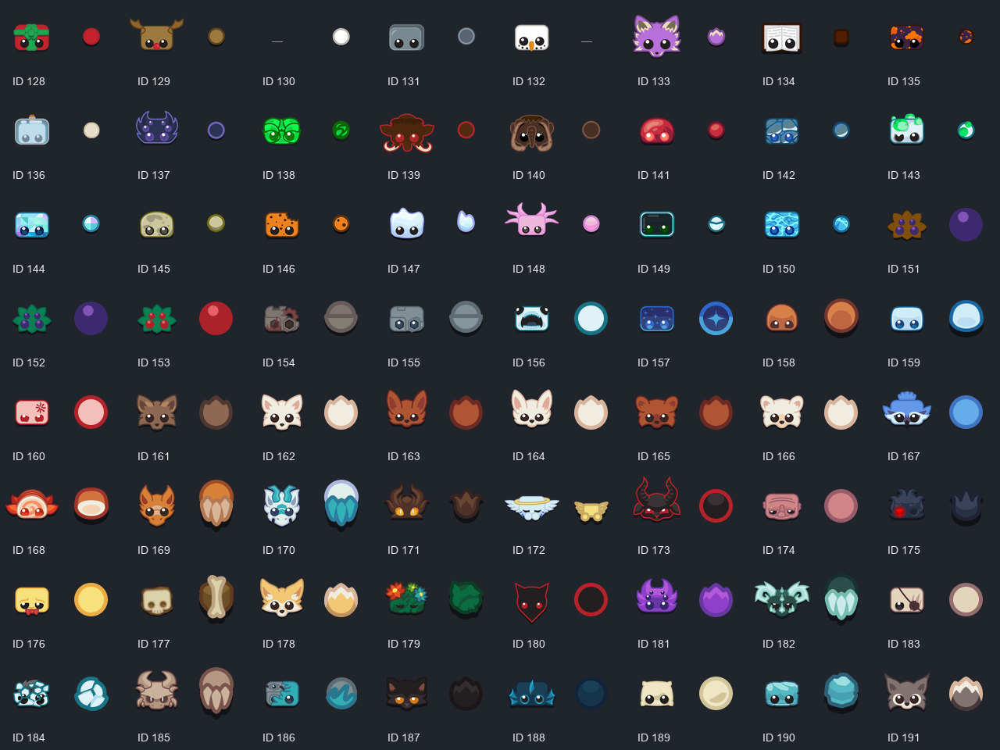

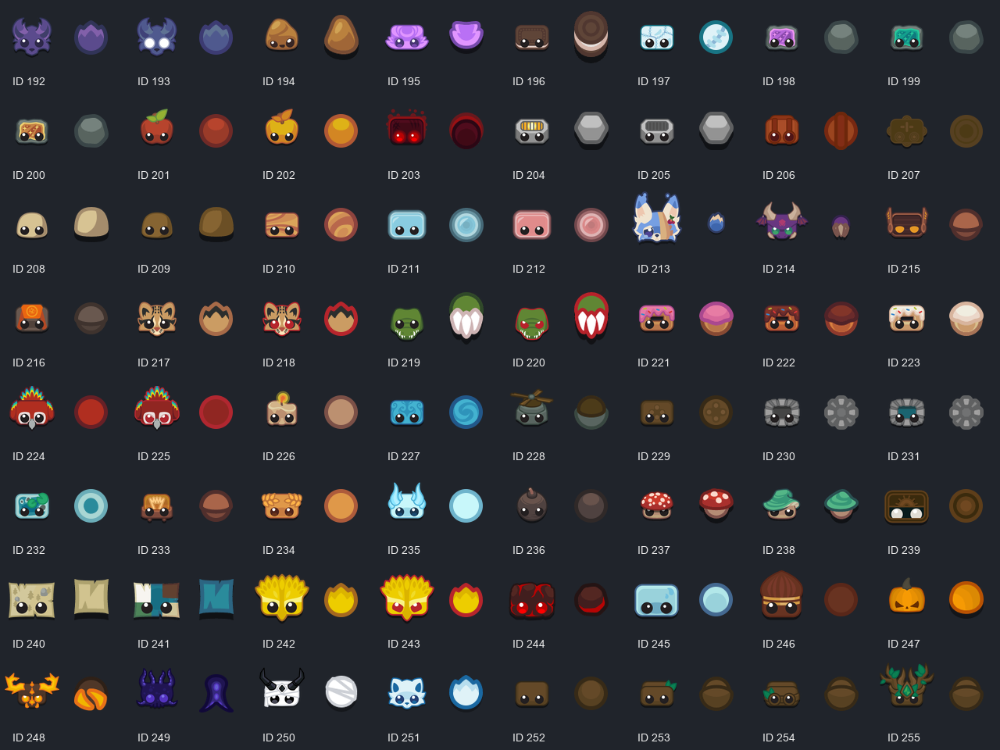

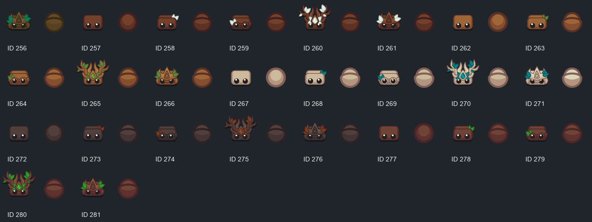

Scripts, ambos executados a partir da raiz do projeto: `scripts/catalog-cosmetic-references.mjs` baixa, valida e cataloga as imagens, e `scripts/build-cosmetic-contact-sheets.py` monta as pranchas.

## Para a etapa de modelagem

As imagens são referências 2D, não modelos 3D. Antes de produzir cada skin, conferir se mãos, acessórios, animações ou outras peças usam arquivos separados. Os IDs permitem selecionar o lote de produção sem inventar nomes. Nenhum modelo foi criado e nenhum asset foi importado no Roblox nesta consulta.
