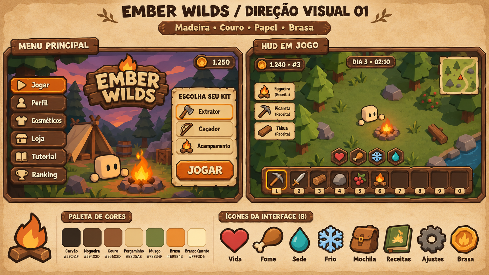
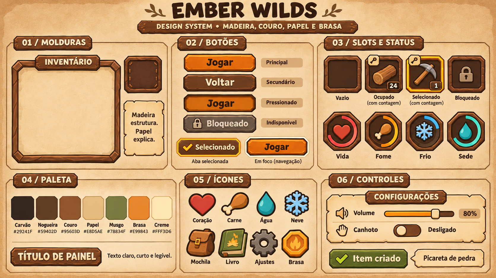
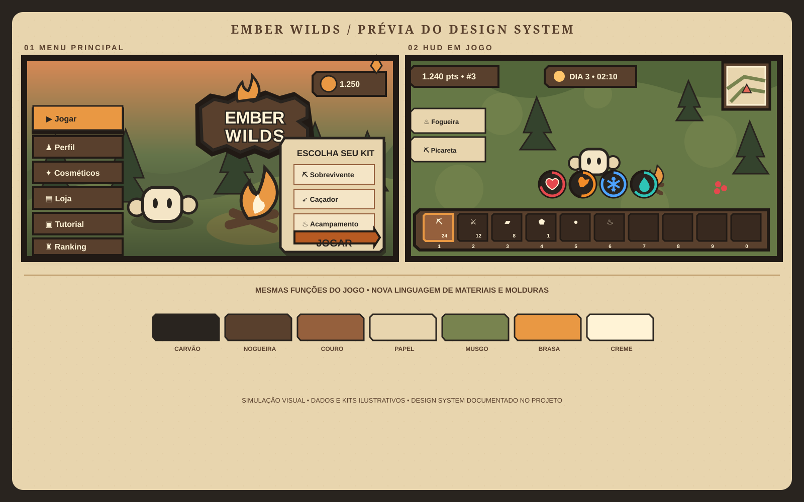

# Ember Wilds — Design system rústico
Versão 1.0 · 3 de novembro de 2026 · direção visual escolhida pelo usuário.

Este documento define o visual das interfaces do jogo: marca, materiais, cores, formas, componentes, ícones, movimento e composição das telas. É a especificação para a produção. A implementação atual ainda usa o tema anterior.

A [prancha aprovada](../propostas/rustica-v1/prancha.png) estabelece a aparência. Os valores de produção estão em [tokens.json](tokens.json). Quando uma imagem gerativa divergir em texto, quantidade de slots ou proporção, seguir este documento e os tokens. O nome **Ember Wilds** continua provisório; a composição da marca foi escolhida como referência.

A prancha de componentes foi criada com a ferramenta integrada ImageGen, usando a direção escolhida como referência. O [prompt de geração](prompt-componentes.txt) está salvo para reprodução. Letras, códigos de cor e detalhes gerados na imagem são ilustrativos; os tokens e as regras abaixo são a especificação exata. As pequenas chaves desenhadas nos cantos dos slots representam incorretamente os atalhos: na UI final, esses cantos mostram os números 1–0 conforme descrito no guia.

## 1. Personalidade e regra dos materiais

A interface parece feita no próprio acampamento: placas talhadas, botões revestidos de couro, páginas de um diário e pequenas peças de metal escurecido. As formas têm peso e volume discreto. O resultado deve ser acolhedor, aventureiro e fácil de reconhecer em uma partida rápida.

**Madeira estrutura. Couro convida à interação. Papel explica. Brasa destaca a ação.**

| Material | Função | Aparência |
|---|---|---|
| Madeira | Molduras, títulos, navegação, base da hotbar | Nogueira escura, cortes retos, cantos chanfrados, luz na borda superior |
| Couro | Botões secundários, slots, abas | Marrom quente, miolo limpo, sombra interna e costura apenas em peças grandes |
| Papel | Kits, receitas, estatísticas, configurações, descrições | Creme envelhecido, borda irregular contida e texto carvão |
| Metal | Engrenagem, fecho, pequenos marcadores | Carvão com uma face clara, sem cromado |
| Brasa | Jogar, seleção, moeda, feedback principal | Âmbar/laranja, brilho localizado, contraste forte |

A madeira recebe no máximo dois ou três veios largos por peça. Detalhes ficam nas bordas e não atravessam textos. Papel não tem manchas fortes atrás de informação. Couro de um slot pequeno dispensa costura. A luz dos elementos desenhados vem de cima à esquerda; a sombra cai abaixo à direita.

As telas mantêm a mesma linguagem de materiais. O HUD usa versões mais simples e compactas desses materiais, para deixar o mundo visível.

## 2. Cores

### Paleta de materiais

| Token | Hex | Uso |
|---|---|---|
| material.outline | #211A15 | Contorno externo e sombra mais profunda |
| material.charcoal | #29241F | Fundos escuros e tinta sobre papel |
| material.woodShadow | #38291F | Espessura inferior da madeira |
| material.walnut | #59402D | Corpo da madeira |
| material.woodLight | #805739 | Face iluminada da madeira |
| material.woodEdge | #AD7745 | Filete e pequenos cortes na madeira |
| material.leatherShadow | #68432D | Rebaixo de couro |
| material.leather | #95603D | Face de botão secundário |
| material.leatherLight | #B87C4B | Borda superior do couro |
| material.paperShadow | #B99462 | Desgaste e sombra do papel |
| material.paper | #E8D5AE | Área de leitura |
| material.paperLight | #F4E5C6 | Papel elevado ou selecionado |
| material.moss | #78834F | Livro, tecido e decoração natural |
| material.emberShadow | #B75A22 | Espessura da ação principal |
| material.ember | #E99843 | Ação principal e seleção |
| material.emberLight | #FFC66B | Luz da brasa e hover |
| material.cream | #FFF3D6 | Texto sobre fundo escuro |

### Cores por significado

| Função | Cor | Regra |
|---|---|---|
| Texto em superfície escura | #FFF3D6 | Rótulos, valores e botões de couro |
| Texto em superfície clara | #29241F | Papel e botão de brasa |
| Texto secundário escuro | #C9B898 | Sobre carvão ou nogueira |
| Texto secundário claro | #59402D | Sobre papel |
| Ação e seleção | #E99843 | Uma ação dominante por painel |
| Foco de navegação | #FFF3D6 | Segundo contorno, externo ao selecionado |
| Sucesso | #92B56A | Check e informação de conclusão |
| Aviso | #F4C46A | Triângulo e texto explicando o aviso |
| Perigo | #E56A59 | Ação destrutiva, erro ou dano |
| Fundo indisponível | #51483D | Botão sem ação disponível |
| Texto indisponível | #B9AA91 | Rótulo e motivo da indisponibilidade |

O verde musgo é decorativo: não usar texto carvão pequeno sobre ele. Estado nunca depende só de cor: selecionado tem marca, bloqueado tem cadeado, erro tem ícone e frase.

Contrastes calculados para cores sólidas, antes de textura: creme/carvão **13,94:1**; creme/nogueira **8,67:1**; creme/couro **4,74:1**; carvão/papel **10,66:1**; carvão/brasa **6,61:1**. A meta interna é pelo menos 4,5:1 para texto comum. O couro tem pouca margem para variação; por isso a área atrás do texto deve ser lisa. Textura, transparência e imagens finais precisam de nova conferência.

### Status e tiers

Preservar as cores atuais do jogo para não romper a associação entre recursos, ferramentas e interface.

| Status | Cor | Símbolo |
|---|---|---|
| Vida | #E5484D | Coração |
| Fome | #F28C28 | Coxa de alimento |
| Frio | #4DA3FF | Floco de seis pontas |
| Sede | #2EC4B6 | Gota |
| Oxigênio | #E8F4FF | Bolha |
| Calor | #FF6B35 | Sol com ondas de calor |

| Tier | Cor |
|---|---|
| Madeira | #8B5A2B |
| Pedra | #8A8F98 |
| Ouro | #F2B632 |
| Diamante | #3FD0E0 |
| Ametista | #9B5DE5 |
| Reidite | #D63384 |
| Esmeralda | #2ECC71 |

Tier ocupa uma faixa ou pequenos cantos internos do slot. Seleção usa o perímetro externo de brasa, mais um marcador claro. Assim um item de ouro selecionado continua distinguível. O material não muda a cor do texto da quantidade. Esmeralda mantém o papel especial definido pelo jogo, sem inventar uma nova posição na progressão.

## 3. Logo e símbolo

### Logo principal

Preservar a composição do logo dentro do menu da prancha:

- Duas linhas centralizadas: **EMBER** em cima, **WILDS** embaixo.
- Letras largas, pesadas, de cantos suavizados, com pequenas irregularidades de desenho.
- Frente creme, sombra ocre discreta e contorno carvão grosso.
- Espessura escura abaixo das letras, transmitindo madeira esculpida.
- Fundo de tábuas horizontais sobrepostas, com laterais de comprimentos ligeiramente diferentes.
- Chama central no topo, ultrapassando a silhueta das tábuas.
- Silhueta geral compacta, mais larga que alta, sem faixa adicional de subtítulo.

O desenho das letras da prancha é uma referência de lettering. Luckiest Guy é a fonte de títulos do sistema, mas não reproduz exatamente esse logo. A arte final da marca deve ser redesenhada a partir da referência escolhida, mantendo a composição, em vez de simplesmente digitar o nome numa fonte parecida.

### Proporções de construção

Usar uma caixa nominal de 100 unidades de largura por aproximadamente 70 de altura. A chama ocupa cerca de 20 unidades de largura, entre as alturas 0 e 22; a placa ocupa aproximadamente x=4–96 e y=16–68. A primeira linha ocupa a faixa y=23–42 e a segunda y=43–62. Ajustar opticamente na arte final, sem deformar as letras.

Contorno externo de 1,5–2 unidades; profundidade das letras de 1,5–2,5; veios de madeira discretos, sempre atrás do lettering. Área livre mínima ao redor: **8% da largura total**. Largura mínima do logo completo: **180 px lógicos**. Abaixo disso, usar o símbolo.

### Família de marca

| Versão | Uso |
|---|---|
| Principal, com tábuas e chama | Menu, abertura e materiais de apresentação |
| Símbolo: chama sobre duas toras | Carregamento compacto e aplicações sem espaço para nome |
| Silhueta monocromática | Gravação, selo e fundos com pouco contraste |
| Moeda octogonal com chama | Golden Ember; deve continuar distinta da fogueira |

A chama tem base larga, uma ponta principal inclinada e uma língua interna clara; dois ou três campos de cor bastam. As toras se cruzam, com corte frontal hexagonal e miolo claro. Não acrescentar espadas, escudos ou personagens ao logo principal.

Não esticar, rotacionar o conjunto, aplicar brilho neon, trocar a cor conforme tier ou redesenhar o símbolo em cada tela. Evitar usar o logo completo como decoração repetida dentro dos painéis. O nome da moeda segue os textos reais do projeto.

## 4. Tipografia

As famílias abaixo já são referenciadas pelo tema atual do projeto. A validação visual final será feita dentro do Studio.

| Papel | Família | Peso | Tamanho base / entrelinha |
|---|---|---|---|
| Destaque de tela | Luckiest Guy | Regular | 40 / 1,10 |
| Título de painel | Luckiest Guy | Regular | 28 / 1,15 |
| Seção | Builder Sans | Bold | 22 / 1,20 |
| Botão | Builder Sans | Bold | 20 / 1,20 |
| Rótulo | Builder Sans | Bold | 16 / 1,25 |
| Corpo | Builder Sans | Medium | 16 / 1,40 |
| Legenda | Builder Sans | Medium | 14 / 1,35 |
| Valores de HUD | Fredoka One | Regular | 20 / 1,15 |

Usar caixa alta em títulos curtos, como “ESCOLHA SEU KIT”. Botões e textos de uso normal ficam em frase: “Jogar”, “Pegar tudo”, “Faltam 3 madeiras”. Valores alinhados em colunas e com espaço reservado para crescer.

Texto em painel liso não precisa de contorno. Sobre o mundo, aplicar sombra/contorno discreto e uma base de leitura quando necessário. Não aplicar stroke grosso em parágrafos. Números de slot podem usar 12 px; informação essencial fica em 14 px ou mais. Rótulos longos quebram linha ou recebem mais espaço antes de reduzir tamanho.

O texto funcional continua editável e localizado. Somente o logo final incorpora lettering à imagem.

## 5. Geometria, molduras e profundidade

Todas as medidas seguintes são **pixels lógicos na escala 1**. A arte pode ser exportada em resolução maior. Cantos chanfrados são pequenos cortes retos em aproximadamente 45°, mantendo lados longos bem definidos.

### Anatomia da moldura

De fora para dentro:

1. Sombra sólida escura, deslocada 3 px para baixo.
2. Contorno carvão de 2 px; 3 px em peças de destaque.
3. Faixa de madeira de 8 px; 12 px em painéis grandes.
4. Filete superior/esquerdo de 2 px em madeira clara.
5. Rebaixo interno em madeira escura de 2 px.
6. Conteúdo em couro, papel ou carvão, com margem própria.

O contorno externo se mantém mesmo na parte sombreada. Luz só nas faces superiores/esquerdas, sombra nas inferiores/direitas. Evitar desenhar um contorno luminoso uniforme em tudo.

| Peça | Forma | Corte do canto | Tratamento |
|---|---|---|---|
| Botão compacto | Retângulo comprido chanfrado | 4 px | Contorno 2 px e bevel 2 px |
| Botão padrão / slot | Retângulo ou quadrado chanfrado | 8 px | Face limpa, base sombreada |
| Painel grande | Retângulo chanfrado | 12 px | Moldura de madeira 12 px |
| Placa de título | Retângulo horizontal | 8 px | Duas pequenas marcas de madeira nas extremidades |
| Medalhão de status | Octógono | Proporcional | Casca escura, símbolo e indicador interno |
| Moeda | Octógono com aro interno | Proporcional | Chama central; sem texto minúsculo |
| Papel | Retângulo de cantos levemente irregulares | Entalhes até 4 px | Borda ocre e área central limpa |

Para construir um retângulo chanfrado de largura W, altura H e corte C, o contorno passa por: (C,0), (W−C,0), (W,C), (W,H−C), (W−C,H), (C,H), (0,H−C), (0,C). Nos slots pequenos, usar C=4 para não perder área útil. O octógono do medalhão tem cortes maiores, próximos de 25% do lado.

Costura é um detalhe opcional: traços de 3 px, intervalo de 4 px, afastados 6 px da borda. Usar em painéis de couro grandes; retirar em componentes compactos. Papel recebe dois ou três entalhes por lado longo, sem borda serrilhada contínua.

### Ritmo e espaçamento

Escala: **4, 8, 12, 16, 20, 24, 32, 40, 48**. Entre ícone e texto: 8–12. Entre controles relacionados: 8. Entre grupos: 24. Margem interna de painel: 24 desktop, 16 compacto. A textura nunca substitui a hierarquia de espaçamento.

## 6. Componentes

### Botões

Alturas: compacto 44, padrão 52, principal 60. Margem horizontal de 20; ícone de 24 ou 32 com intervalo de 8. O botão principal tem face de brasa e texto carvão. Secundário tem couro e texto creme. Ação discreta usa uma pequena placa de nogueira. Botão destrutivo usa cor de perigo, texto escuro e verbo explícito.

| Estado | Aparência | Comportamento |
|---|---|---|
| Normal | Face, bevel e sombra completos | Rótulo descreve a ação |
| Hover | Face mais clara, sem mudar tamanho do layout | Apenas quando houver ponteiro |
| Pressionado | Face desce 2 px e sombra encurta | 80 ms; alvo clicável permanece estável |
| Selecionado | Contorno brasa de 3 px e marcador | Persiste enquanto a opção estiver ativa |
| Focado | Contorno creme de 2 px com folga de 2 px | Pode coexistir com selecionado |
| Indisponível | Face cinza-marrom, rótulo legível | Sem ação, motivo visível ou acessível |
| Processando | Indicador e texto de progresso | Preservar largura; evitar envio duplicado |

Não depender de hover para explicar uma ação no celular. Fechar é um X de 20–24 dentro de área de toque 44×44, alinhado no cabeçalho.

### Painéis, abas e diálogos

Painel de leitura usa papel; painel de equipamentos usa couro escuro. Cabeçalho de madeira com título à esquerda e fechar à direita. O conteúdo pode rolar; cabeçalho e ação principal permanecem acessíveis. Não cobrir o último item com rodapé fixo.

Abas parecem marcadores de couro. A ativa ganha filete de brasa e rótulo reforçado; as demais preservam contraste. Rolagem de abas deve ser indicada quando nem todas couberem.

Modal central tem largura máxima de 960 e margem externa mínima de 24, ou 12 no compacto. Fundo escurecido carvão a 60% de opacidade. Um único modal principal por vez. Escape/voltar fecha o painel superior quando permitido; foco retorna ao controle de origem na implementação.

### Slots de item e hotbar

Tamanho padrão 56×56, compacto 44×44, catálogo ampliado 64×64. Ícone ocupa aproximadamente 76% do quadrado. Quantidade no canto inferior direito sobre pequena base escura; tecla no superior esquerdo, sem sobrepor a quantidade.

Estados: vazio mostra rebaixo de couro; ocupado mostra ícone; selecionado ganha contorno externo e marca; bloqueado mostra cadeado; cooldown usa máscara e indicador de tempo; arrasto mostra cópia visual, mantendo o lugar de origem identificável.

A cor do tier aparece em faixa interna. Quantidade e cooldown são camadas funcionais, não parte da arte do ícone. Durabilidade só aparece quando houver esse dado no jogo.

A hotbar contém **exatamente dez slots**. A prancha original repetiu uma tecla/slot; esse detalhe não pertence ao sistema. Desktop: teclas 1–9 e 0. Botão de mochila fica separado da contagem dos slots.

### Status

Medalhão externo de oito lados, miolo carvão, símbolo colorido e **anel circular de preenchimento contínuo** dentro da moldura. O anel mantém a leitura funcional que já existe; o octógono dá identidade à peça.

Tamanho 52, ou 44 no compacto. Símbolo de 24 no padrão. Mostrar valores em faixa auxiliar na versão expandida e em inspeção, sem depender só do símbolo. Vida usa o máximo real do jogador.

Abaixo do limiar configurado, acrescentar marca de aviso e pulso suave de brilho; o indicador não desaparece no ponto mínimo do pulso. Os valores e limiares continuam vindo das regras atuais. Frio/calor alternam no mesmo lugar quando o jogo indicar; oxigênio permanece contextual. Não inventar novas regras de sobrevivência no redesenho.

### Cards de receita e item

Card de receita com papel, ícone, nome e ingredientes. Disponível: check verde e ação “Criar”. Indisponível: cadeado ou requisito faltante em texto; ícone continua identificável. Em progresso: tempo e ação de cancelar conforme o fluxo existente.

Cards de cosméticos usam base de couro, prévia do item, nome e estado “Equipado”, “Disponível” ou “Bloqueado” conforme os dados reais. Seleção para prévia e item equipado devem ter marcas diferentes.

### Controles de configuração

Slider: trilho escuro de 8 px, preenchimento de brasa, puxador chanfrado de 24 px dentro de alvo de pelo menos 44 px; valor numérico à direita. Toggle: trilho de couro, posição marcada e texto “Ligado/Desligado”. Escolha entre opções: segmentos com o mesmo estado de seleção dos botões.

Campos de texto, quando necessários: papel claro, contorno nogueira, foco creme sobre contorno escuro e rótulo persistente. Erro aparece abaixo em texto, sem depender apenas da borda.

### Informações pequenas

Tooltip em papel, largura máxima de 280, padding 12, título 16 e descrição 14. Não ultrapassar a área segura. No toque, usar inspeção explícita quando pressionar já executar uma ação.

Notificação: placa compacta com ícone e frase curta. Máximo de duas, duração padrão de 3 s; erros que precisam de ação permanecem próximos ao controle. Pontos, moeda e relógio usam placas estreitas, com espaço reservado para os valores.

Vazio: símbolo simples, título curto e próximo passo. Exemplo: “Mochila vazia” e “Colete recursos para começar”. Erro: explicar o que não aconteceu e como tentar novamente.

## 7. Sistema de ícones

Os ícones são pequenas ilustrações, com silhueta grossa, contorno carvão e duas ou três massas de cor. Formas levemente angulares, volume curto e um brilho no alto à esquerda. A leitura da silhueta vem antes do detalhe.

### Construção

Fonte de 512×512 com transparência real. Reservar 12% de margem por lado; o objeto ocupa aproximadamente 76% da caixa, com ajustes ópticos. Contorno-base de 16 px na fonte, equivalente a 1,5 px em 48 px. Detalhes internos podem usar metade dessa espessura; remover os que desaparecerem no teste reduzido.

Exportações de 128 e 256 para uso normal e ampliado. Testar a arte a 24, 32 e 48 px; usar uma versão simplificada para ícones de navegação a 20–24. Não gravar moldura, quantidade, tecla ou cor de seleção na imagem. Isso pertence ao componente.

| Ícone | Desenho | Cor dominante / detalhe |
|---|---|---|
| Vida | Coração largo com pequeno brilho | Vermelho |
| Fome | Coxa inclinada, osso grande e legível | Laranja-marrom e creme |
| Sede | Gota larga com uma face iluminada | Turquesa |
| Frio | Floco de seis braços grossos | Azul e azul-claro |
| Calor | Sol com três ondas simples | Laranja |
| Oxigênio | Uma bolha com reflexo curto | Branco azulado |
| Mochila | Corpo trapezoidal, aba e uma fivela | Couro |
| Receitas / tutorial | Livro fechado com páginas claras e selo de chama | Musgo, creme e brasa |
| Ajustes | Engrenagem de oito dentes largos | Carvão e metal claro |
| Golden Ember | Moeda octogonal com aro e chama | Brasa |
| Perfil | Busto simplificado do boneco próprio | Creme |
| Jogar | Triângulo sólido levemente chanfrado | Creme ou carvão conforme fundo |
| Cosméticos | Camiseta de silhueta simples | Creme |
| Loja | Toldo com duas ou três divisões | Madeira e creme |
| Ranking | Taça larga com duas alças | Ocre e brasa |
| Fechar / voltar | X de duas hastes / seta curta | Cor do texto |
| Bloqueado / concluído | Cadeado / check | Creme / verde de sucesso |

Livro de tutorial e livro de receitas compartilham a família, mas o primeiro pode usar uma pequena marca “?” em tamanhos grandes. Não diferenciar somente por cor.

Itens já modelados mantêm sua forma reconhecível. O redesenho do sistema não exige refazer todos os recursos 3D. Quando forem usados renders, aplicar enquadramento e iluminação consistentes; não substituir um item por outro só para combinar com a prancha.

## 8. Layout e comportamento em telas diferentes

Unidade de referência: pixel lógico. “Compacto” é escolhido quando a área disponível tiver largura abaixo de 900 **ou** altura abaixo de 500. Isso muda a composição; não é uma ordem para reduzir a tela inteira.

Medir a área útil após barra do Roblox, recortes e margens seguras. Margem mínima: 24 desktop, 12 compacto. Todos os alvos de toque têm pelo menos 44×44 **após** escala. A escala de interface atual de 0,8 a 1,25 precisa ser considerada no cálculo, preservando esse mínimo.

### Menu

Desktop: navegação de 200 px à esquerda, centro para logo/cena e cartão de kit à direita. Compacto: navegação de 144 px, logo menor e painel de conteúdo ocupando o restante; reduzir decoração antes de cortar conteúdo. A navegação e listas podem rolar verticalmente, mantendo seus alvos de toque.

Em telas ainda mais estreitas, trocar a coluna por um botão de navegação que abre uma lista. Não transformar seis rótulos em seis ícones sem explicação.

### HUD

Pontos no alto à esquerda; dia/tempo no alto central; minimapa no alto à direita; receitas junto à borda esquerda; hotbar abaixo; status acima dela. O centro permanece livre de painéis persistentes.

No celular, reservar zonas inferiores para movimento e mira. Essas zonas trocam de lado conforme a configuração de canhoto. Placas de informação e modal não devem capturar gestos fora dos seus limites.

A composição da hotbar depende do **espaço medido entre controles**, não apenas da largura total:

- Linha desktop: 10×56 + 9×6 + 2×12 = **638 px**.
- Linha compacta: 10×44 + 9×4 + 2×8 = **492 px**.
- Se a linha não couber, usar duas linhas de cinco: 5×44 + 4×4 + 2×8 = **252 px** de largura, **108 px** de altura.
- Ordem em duas linhas: 1–5 em cima, 6–0 embaixo.
- Se nem a grade couber entre os controles após escala, colocá-la numa faixa acima deles, recalculando a posição dos status.

A grade de duas linhas é uma regra nova de layout a implementar e validar. O tamanho de toque não pode ser reduzido para forçar dez slots na mesma linha. Em janelas de pouca altura, priorizar HUD essencial, recolher a lista de receitas para um botão e usar painéis roláveis.

Configurações de escala máxima e dispositivos pequenos precisam de ensaio real. Não considerar os breakpoints como prova de ausência de sobreposição.

## 9. Aplicação a todas as telas atuais

| Tela | Composição e material | Conteúdo e ação |
|---|---|---|
| Carregamento | Fundo do acampamento, símbolo de fogueira, trilho de madeira | Progresso real quando disponível; texto curto |
| Menu / Jogar | Logo sobre cena, navegação de madeira, kit em papel | Kits reais, pontos, saldo e “Jogar” |
| Perfil | Folha de diário com cabeçalho de madeira | Nome, nível e estatísticas; dados simulados identificados |
| Cosméticos | Categorias em abas, boneco central, grade de couro | Prévia, nome, estado e ação de equipar quando funcional |
| Loja | Cards organizados em papel e madeira | Preço explícito, conteúdo e chance quando aplicável; preservar fluxo simulado |
| Compra de moeda | Pacotes em cards com moeda consistente | Quantidade, preço e ação; usar os dados existentes |
| Ranking | Quadro de papel com linhas alternadas suaves | Posição, jogador, pontos; linha própria destacada com marcador |
| Tutorial | Livro com páginas e ilustrações grandes | Uma instrução principal por etapa, navegação clara |
| Configurações | Papel, grupos de opções e cabeçalho fixo | Volumes, qualidade, escala e canhoto |
| HUD | Versões simplificadas de madeira/couro | Status, hotbar, relógio, pontos, mapa, receitas |
| Inventário | Grade de couro, título e capacidade | Mover, selecionar, inspecionar e descartar pelo fluxo atual |
| Livro de receitas | Papel com abas por estação | Requisitos, ingredientes e ação de criar |
| Baú / caixa | Painel compacto de couro acima da hotbar | Conteúdo, quantidades e ações existentes |
| Interação com estrutura | Placa curta e botões disponíveis | Nome, estado e ações como beber, alimentar, pegar ou deitar |
| Morte | Mundo atenuado e folha de resumo central | Causa, dias, pontos, moeda, “Jogar de novo” e “Menu” |

O selo “MOCKUP” permanece visível nos fluxos que hoje usam dados simulados. O redesign não transforma compra, cosmético ou ranking simulado em recurso real.

Painéis contextuais de baú, caixa e estrutura mantêm os dados e prioridade atuais. Se a pilha não couber, o layout deve reunir os conteúdos em um painel com seções/abas identificadas; essa adaptação precisa preservar todas as ações, sem esconder interação silenciosamente.

Na morte, o clima fica mais quieto; o material não vira um tema diferente. “Jogar de novo” usa brasa; “Menu” usa couro.

## 10. Movimento e feedback

| Evento | Tempo | Movimento |
|---|---|---|
| Hover | 100 ms | Clarear a face |
| Pressionar | 80 ms | Descer a face em 2 px |
| Selecionar | 120 ms | Aparecer contorno e marcador |
| Abrir painel | 180 ms | Subir 12 px e aparecer |
| Fechar painel | 140 ms | Descer 8 px e desaparecer |
| Receber item | 150 ms | Ícone cresce até 108% e retorna |
| Entrar notificação | 160 ms | Deslocamento curto de 12 px |
| Permanência de aviso simples | 3 s | Sem animação contínua |

Usar desaceleração suave nas entradas e aceleração nas saídas. Sem balanço contínuo de botões, logo flutuando o tempo todo ou partículas atrás de parágrafos. Alertas não deslocam o alvo de toque.

Som de interface curto: madeira ao abrir painel, toque seco ao pressionar, papel ao trocar página e pequeno brilho ao receber moeda. São diretrizes de produção sonora, não assets já criados. Respeitar as configurações de volume existentes.

Uma opção de movimento reduzido é recomendada para produção futura: substituir deslocamentos por fades e retirar pulsos decorativos. Ainda não existe nas configurações atuais.

## 11. Produção e integração

### Arquivos de arte a produzir

| Grupo | Exemplos de arquivos | Fonte / entrega |
|---|---|---|
| Marca | logo_primary, mark_campfire, mark_mono | Vetor editável + PNG transparente; fonte do logo com pelo menos 2048 px de largura |
| Molduras | panel_wood, panel_paper, slot_leather | Fonte em camadas + PNG transparente com áreas de borda definidas |
| Botões | button_primary, button_secondary | Base e camadas de estado; rótulos separados |
| Status | status_frame, status_track | Casca e trilho separados do preenchimento |
| Ícones | icon_ui_health, icon_ui_backpack, icon_ui_settings | Fonte 512; PNGs 128/256 |
| Moeda | icon_currency_ember | Mesmo enquadramento e linguagem dos ícones |
| Detalhes | tab_leather, badge_key, divider_wood | Poucas variantes reutilizáveis |

As pranchas não são atlases prontos para recortar e importar. O logo ainda precisa de arte final isolada; os ícones precisam de arquivos individuais e as molduras precisam de áreas de redimensionamento. Não exportar textos de botões dentro das texturas.

Para painéis redimensionáveis, separar cantos, bordas e centro; usar escalonamento de nove regiões quando a arte permitir. Irregularidade do papel fica nos cantos e nas bordas preservadas, sem esticar entalhes. Contornos chanfrados não devem ser substituídos por cantos totalmente redondos.

### Mapeamento para o projeto atual

| Arquivo existente | Papel na migração |
|---|---|
| src/shared/Palette.luau | Receber as cores de UI; manter tiers e status |
| src/shared/Theme.luau | Fontes, medidas e estados reutilizáveis |
| src/client/UI/Kit.luau | Construir painéis, placas e controles no novo estilo |
| src/client/UI/ItemIcon.luau | Continuar exibindo o item, separado da moldura |
| src/client/UI/StatusRing.luau | Manter preenchimento funcional; acrescentar casca e símbolo |
| src/client/UI/SlotButton.luau | Seleção, foco, quantidade e tier |
| src/shared/UIFlow/MenuLayout.luau | Ajustar composição e medidas após protótipo |
| assets/ui/*.model.json | Atualizar moldes preservando nomes e classes procurados pelos scripts |
| src/client/Menu/ | Aplicar o sistema aos painéis atualmente construídos em código |
| src/shared/Strings/ptBR.luau | Manter todos os textos funcionais localizados |

Os tokens neste diretório são especificações de design, não um módulo carregado pelo jogo. Não substituir a Palette inteira automaticamente: há cores usadas também pelo mundo e pela progressão. A integração precisa mapear funções semânticas e conferir cada tela.

### Critérios de aceite visual

- Logo mantém as duas linhas, a chama e o suporte de tábuas.
- Botões, molduras e slots compartilham chanfro, direção de luz e contorno.
- Texto essencial legível, sem textura forte ou imagem por trás.
- Ícones reconhecíveis em tamanho real; contagem e tecla não embutidas.
- Exatamente dez slots; seleção identificável em todos os tiers.
- Anéis mostram valores reais e não viram simples medalhões decorativos.
- Layout conferido em 1920×1080, 1280×720, 844×390, 667×375 e 568×320, além de tablet.
- Conferir escala 0,8, 1 e 1,25, textos longos, jogador canhoto e áreas seguras reais.
- Validar kit vazio, inventário cheio, falta de ingredientes, carregamento, erro, item bloqueado e compra simulada.
- Fechar, voltar, navegar, arrastar e tocar continuam funcionando nos fluxos existentes.
- Comparar o custo do HUD antes/depois, especialmente imagens, texturas e prévias 3D.

## 12. Estado desta entrega

Entregues: especificação do design system, tokens estruturados e referência visual aprovada. A prancha complementar de componentes é uma ilustração do sistema; medidas, cores e comportamento exatos vêm deste documento.

Permanecem etapas de produção: arte final isolada da marca, exportação dos assets por componente, integração às telas e teste no Studio. A aprovação do estilo está registrada; essas etapas não exigem escolher novamente uma direção visual.

