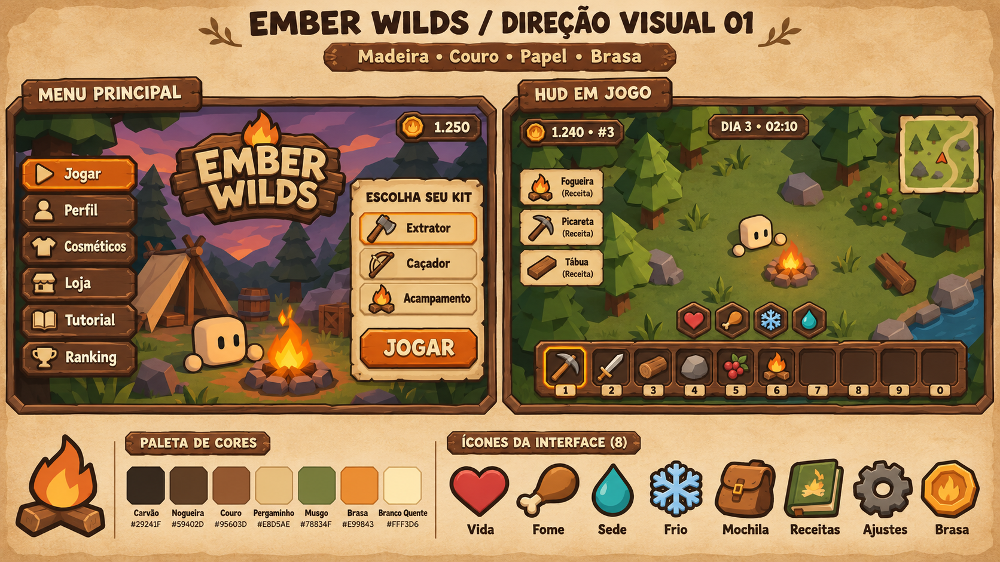

# Direção rústica — proposta 01

> Direção escolhida pelo usuário em 03/11/2026. A especificação atual está no [Design system rústico v1](../../design-system/README.md), com regras detalhadas de marca, componentes, cores, ícones e layout. Esta prancha permanece como referência visual aprovada.

Data: 2026-11-03. Direção escolhida pelo usuário: sobrevivência rústica, com madeira, couro, papel e tons naturais. Nome provisório: Ember Wilds.

Esta proposta visual foi gerada com a ferramenta integrada ImageGen. Não é uma captura do jogo nem uma UI implementada. Os arquivos e guias atuais foram inspecionados; não havia instância do Studio conectada para conferir o jogo rodando. O código existente não foi alterado.

## Identidade

Fogueira como símbolo, molduras de madeira com cantos chanfrados, couro escuro nos controles e papel claro nas informações. Poucos detalhes grandes, silhuetas robustas e sombras simples combinam com o mundo low-poly e os itens existentes. Usar textura com moderação, concentrada nas bordas; a área de leitura deve permanecer limpa.

| Papel | Cor proposta |
|---|---|
| Fundo carvão / contorno | `#29241F` |
| Madeira nogueira | `#59402D` |
| Couro | `#95603D` |
| Papel | `#E8D5AE` |
| Musgo | `#78834F` |
| Ação / brasa | `#E99843` |
| Texto claro | `#FFF3D6` |

Estes valores são a especificação proposta; a imagem generativa é uma aproximação. Vida, sede, frio e fome mantêm cores semânticas distintas. Cores dos tiers existentes continuam identificando os materiais.

Títulos podem usar a Luckiest Guy já configurada; rótulos e textos usam Builder Sans. A aparência exata das letras do logo da prancha é ilustrativa. Texto de interface deve continuar sendo texto real, com localização e escala, nunca incorporado ao fundo da imagem.

## Componentes e telas

- Menu: navegação lateral com símbolo e rótulo, destaque de brasa na seleção, cena do mundo visível e cartão de escolha de kit em papel. Nomes e itens de kits na imagem são ilustrativos; a implementação usa as definições reais.
- HUD: placas pequenas para pontos e relógio, moldura discreta para minimapa, receitas junto à borda e centro livre para jogar. A moldura externa da prancha não é necessária no jogo.
- Hotbar: dez slots, teclas 1–0, item selecionado com contorno de brasa e quantidades legíveis. A imagem gerada repetiu um slot; não reproduzir esse erro.
- Status: preservar os quatro indicadores funcionais de vida, fome, temperatura e sede. A prancha demonstra os símbolos; o componente final precisa de preenchimento proporcional, valores e estados de alerta.
- Inventário e baú: slots de couro e cabeçalho de papel, com o mesmo desenho de seleção da hotbar.
- Receitas: livro de papel com abas, requisitos claros e estados disponível/indisponível diferenciados por texto e símbolo além da cor.
- Cosméticos e loja: reutilizar molduras, cartões e navegação; manter a prévia do boneco como foco. Os fluxos atualmente simulados permanecem identificados como mockup.
- Configurações: folha de papel com controles simples, sem textura atrás de textos pequenos.
- Morte: resumo da partida em papel e ação principal de brasa; manter causa, dias, pontos e moeda.

## Ícones

Primeiro conjunto conceitual: vida, fome, sede, frio, mochila, receitas, ajustes e brasa. Contorno escuro uniforme, dois ou três tons, silhueta reconhecível em tamanho pequeno. A prancha não substitui arquivos individuais com transparência; esses assets ainda precisam ser produzidos e importados para uso na UI.

## Critérios para implementação

Botões com área de toque mínima de 44 px. Preservar os nomes usados pelos moldes e todos os vínculos de dados existentes. Conferir desktop e celular horizontal, incluindo áreas seguras, dez slots e controles de movimento/mira. Prototipar primeiro menu e HUD em escala real; depois aplicar os componentes às demais telas. A prancha não comprova comportamento responsivo nem contraste no jogo.

## Prompt da geração

Brief usado no ImageGen: criar uma prancha de direção de arte para Ember Wilds, survival Roblox top-down low-poly, com sobrevivência rústica de madeira, couro, papel e tons naturais; dois mockups de menu e HUD, logo com fogueira, paleta carvão/nogueira/couro/pergaminho/musgo/brasa/branco quente e oito ícones de interface. Manter formas robustas, contorno escuro, dois ou três tons, texto legível em português e o boneco próprio arredondado com duas mãos soltas. Menu com navegação lateral e escolha de kit; HUD com pontos, relógio, minimapa, receitas, quatro status e dez slots. Evitar ornamentos excessivos, textura que prejudique a leitura, visual sci-fi e avatar humanoide padrão.
